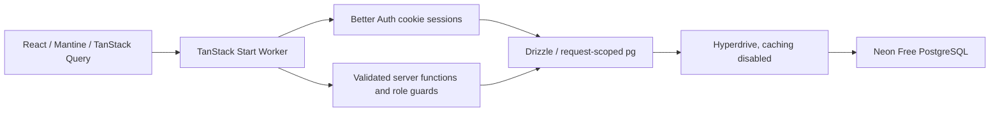

# Application architecture

Local development uses PostgreSQL 17 through Hyperdrive's local connection. CLI migrations and tests connect directly. Each request opens and closes a pg client; there is no global Worker pool or database client passed to browser code.

The auth handler owns `/api/auth/$`. Domain functions validate Zod inputs and derive actors from Better Auth cookies. SQL schema constraints enforce foreign keys, surah range, one grade per student/surah, one open review per student/surah, and one unused reset code per user.

The app and Storybook share `appCssVariablesResolver` for enabled secondary text and placeholders. Light text uses the semantic `onSurfaceVariant` color, independently of the gray ramp retained for borders and disabled controls; dark text uses Mantine `dark[1]`, because the default dark dimmed shade (`dark[2]`) is below 4.5:1 on dark surfaces. Page and TextInput/Textarea backgrounds resolve by color scheme so enabled text keeps contrast on its actual surface. Enabled secondary dashboard/history copy uses `dimmed` instead of a fixed gray shade. Accent labels and links on pages, papers and cards use `--app-accent-text` (`primary[6]` light, `primary[3]` dark), because `primary[6]`/`primary[7]` fall below 1.6:1 on dark surfaces. Gray light/subtle variants take `onSurfaceVariant` as text instead of the `gray[6]` border shade. The top bar and bottom nav stay light glass in both schemes, so their secondary text keeps the fixed light `onSurfaceVariant` color. Token contrast tests and light/dark mobile/desktop browser checks cover these semantics, not a full WCAG audit.

Review close/cancel lock the assignment row. Closing-grade changes and assignment completion share a transaction. Reset redemption locks the account and code, consumes only once, changes credentials and removes sessions in one transaction; failed attempt counters commit before invalid-code errors. All admin role/status/delete operations share a transaction-scoped advisory lock and re-check actor authorization before applying last-admin rules.

Staff can assign a batch of recorded surahs to one student through a validated POST function. The drawer excludes open reviews, supports selection across searches, previews the selection and accepts one optional UTC calendar deadline for the entire batch. Submission locks the active student before checking every selected grade and inserts the batch in one transaction. Missing grades abort the batch; existing open-review conflicts are skipped and reported without changing those assignments. The existing partial unique index and user-before-review lock order protect overlapping batches and grade removal. The drawer waits for completion, retains input on errors and reports assigned/skipped counts; existing review/teacher-dashboard invalidation refreshes the views. The legacy single-review endpoint remains compatible. No schema migration or additional service is needed.

Student and staff student-detail pages include a lazily mounted review-history tab. Its session-authorized GET function returns only completed/cancelled assignments for the selected student, with server-side status filtering and cursor pagination (20 rows plus one lookahead). Ordering uses closure date descending, null dates last, then assignment ID descending; the cursor also handles missing legacy closure dates. The UI displays the saved closing grade rather than the current grade, shows missing details explicitly and formats dates in UTC. History query keys share the reviews prefix, so existing close/cancel and grade-removal invalidations refresh history. Switching students resets the filter and cursor state. No polling, migration or new service is required.

Grade additions, changes and removals now append to `student_grade_history` in the same transaction as the current grade write, including grade changes made while closing a review. Writers keep the existing student-before-review lock order and read the previous grade while holding the student lock. Identical grades, repeated removal, review cancellation and closure without a changed grade add no event. Failure to write history rolls back the grade change and review closure/removal. Existing rows are not backfilled; the first real transition can still include a known previous grade. Events retain nullable previous/new grades, actor reference, timestamp and manual/review source. Student deletion cascades owned history; staff deletion sets the author reference to null and the UI shows a deleted-account fallback. Author names are resolved from current profiles, rather than storing duplicate personal details.

Students and staff can open the separate progress tab (`tab=progress`) with a lazy, session-authorized GET query, optional server-side surah filter and 20-row cursor pagination. Increasing event IDs preserve recording order even for simultaneous timestamps. Composite student/event and student/surah/event indexes keep each page bounded. Dates and times display in UTC. The history query shares the grades prefix, so grade mutations and review closing invalidate both current grades and history. No polling or additional service is introduced. Apply additive migration `0002_grade_history.sql` before deploying the application; it adds an empty history table and does not alter existing product data.

Grades/reviews/notes use stable TanStack Query keys. Mutations invalidate affected keys. Login/logout perform a full document navigation, resetting private query caches. Focus/navigation refetch replaces subscriptions; polling remains off to permit Neon scale-to-zero. Student notes retain nullable staff authors after author deletion; student-owned data cascades on student deletion.

The student home dashboard uses the existing session-scoped grades, open-review and notes queries, sharing cache keys with `/surahs`. Progress counts each grade category and measures mastered (`good`) surahs out of 114, not pages, daily completion or all recorded grades. It previews five open reviews ordered by due date (undated last) and the three newest notes by creation date. Deadline counts use UTC calendar dates, matching review storage. Links select a validated `/surahs?tab=reviews|grades|notes` tab; individual reviews also link to their assignment anchor. Empty states show no invented activity. Teachers and admins now see a staff attention dashboard at home, taking precedence for mixed staff/student roles. A staff-only server function aggregates overdue open reviews, overdue open memorization and forgotten grades independently in one PostgreSQL statement, excluding disabled users and non-student roles. It returns school-wide totals and up to 20 active students ordered by oldest overdue date across reviews and memorization, then forgotten-grade count, name and ID. This follows the existing school-wide staff permissions; there is no teacher/class assignment model. The full student list remains available when the preview is capped. Staff links select a validated student-detail tab, and grade/review/memorization/student/account mutations invalidate the attention query. Pure students retain their private dashboard. Presentation-only fixtures remain available for Storybook. No polling, migration or additional hosting service is introduced. Neon/Hyperdrive provisioning and remote SQL smoke verification are complete. A separate development Worker was deployed and exercised through Hyperdrive/Neon. A confirmed database cold start passed, but actual Worker CPU measurements and HTTP 503 failures show the app is unreliable under the current CPU allowance. See [the hosted verification report](hosted-test-report-2026-10-14.md). Full hosted-suite completion on suitable hosting and production-origin verification remain launch steps.

The hosted findings follow-up upgrades Better Auth to 1.7.7 with compatible native scrypt and atomic PostgreSQL rate-limit counters. The development Worker now uses a separate Neon development branch/Hyperdrive. All five hosted browser checks passed; measured CPU remains above the documented Free allowance. See [the findings follow-up](hosted-findings-followup-2026-10-14.md) for the tested version, measurements and remaining hosting decision.

New whole-surah memorization work lives in `memorization_assignments`, separate from review assignments so review queues and review history keep their existing meaning. A partial unique index permits at most one open assignment per student/surah; student/status/deadline indexing supports the open queue, which is bounded by 114 surahs and ordered by UTC deadline (undated last), assignment time and ID. The session-authorized GET exposes only self/staff records. Staff assignment locks the active student and rejects any recorded grade or existing open task. Assessment locks the student then assignment, requires an explicit grade and rejects stale/closed tasks. The shared transaction-only grade writer appends progress history and closes matching open memorization work atomically, including when a teacher records the first grade through the existing grade flow. History source remains `grade`, since this is first-grade assessment. Assignment and cancellation add no grades/history; cancellation retains the closed task without grading. Closed grading snapshots are not rewritten by later grade edits or removal. Student deletion cascades tasks and deleted staff references become null. The open queue remains separate from lazily expanded assignment history; completed assessments also remain visible through grades/progress history.

The `memorization` tab mounts its query lazily for student/staff pages; the student home loader also preloads it for a separate five-task dashboard preview and links to assignment anchors. Counts include only open memorization tasks and do not count as recorded/mastered surahs. Forms await mutations, block dismissal/duplicate submissions while pending, retain input on errors and show authored recovery guidance. Grade changes invalidate the memorization cache as well as grade/history and attention data; assessment invalidates grades/history and memorization. Polling remains disabled. Apply additive migration `0003_memorization_assignments.sql` before deployment. No hosted migration or new paid service is part of this feature.

The staff attention dashboard independently aggregates overdue open memorization, overdue open reviews and forgotten grades in one statement, avoiding multiplied counts. Today/future/undated and terminal work is excluded using UTC midnight. It counts each active student once, shows separate work-type totals/badges, and orders its 20-student preview by the oldest overdue deadline across either work type, then forgotten-grade count/name/ID. Memorization links open the student memorization tab. All memorization mutations invalidate attention data, including cancellation; direct grading and assessment retain their existing invalidation. No migration, polling or additional paid service is required.

Within `حفظ جديد`, students and staff can expand memorization history without leaving or unmounting the open queue/forms. A session-authorized GET filters completed/cancelled assignments on the server and returns 20 records plus a lookahead, newest closure first with assignment ID as a tie breaker. Cursor values are validated and student scoping is applied on every page. The closure constraint guarantees terminal timestamps. History shows UTC assignment, deadline and completion/cancellation dates, and the saved assessment grade rather than the current grade; cancellation shows no grade. Switching students resets filter/pagination state. History shares the memorization query prefix, so assessment, cancellation and ordinary first grading invalidate it. Empty/error/retry states and mobile RTL presentation are included. No migration, polling or additional service is required.

The history endpoint bounds returned rows, but its existing student/status/due-date index does not provide closure ordering. A local synthetic `EXPLAIN (ANALYZE, BUFFERS)` comparison found low sort cost at the tested sizes and showed a closure-order index alone still scans earlier entries for the current OR cursor. A production index is deferred for the current low-traffic workload; see [the measurement, limitations and repeatable benchmark](memorization-history-query-measurement-2026-11-07.md). This is not a hosted performance guarantee.

Staff can add, change or clear deadlines on open review and memorization assignments. Session-authorized POST endpoints share a server-only transaction that validates a UTC calendar date (or explicit null), locks the active student before the assignment, and re-checks open status and the original deadline under the lock. Stale forms and completed/cancelled work are rejected without changing data. Legacy review timestamps can be supplied as the exact original snapshot and corrected to UTC midnight. Only `due_at` changes: assignment identity, authors, assignment time, grades, progress and closure snapshots stay intact. Concurrent completion and deadline edits serialize through the same student/assignment locks. The shared date dialog awaits writes, blocks pending dismissal/duplicate submissions and preserves input on errors. Student views remain read-only. Existing review/memorization cache invalidation refreshes queues, student dashboard data and staff attention counts; another browser refetches on navigation/focus/reload without polling. No migration or additional service is required.

The staff-only `/staff/work` queue reads open review and memorization assignments through a session-authorized GET. A parameterized UNION ALL query joins active student accounts, including mixed student/staff roles, and applies literal display-name/username substring search (up to 100 characters), work-type and UTC deadline filters. It returns only assignment identity, kind, student identity/display fields, surah and deadline. Terminal work and disabled/nonstudent accounts are excluded on every page. Deadlines are normalized to milliseconds in the read CTE before projection, ordering and cursor comparisons; stored deadlines are unchanged. Due-date ascending/null-last, kind and ID define a deterministic 20-row cursor page plus one lookahead, including tied IDs across tables and undated work. Returned rows are bounded; the existing indexes do not bound school-wide scans/sorts, so further indexing should follow actual measurements if traffic grows. Pagination is a live view: edits/completions between reads may move/remove tasks, and changing filters resets the cursor. URL filters survive navigation; returning from an assignment starts at page one. Search, filters and pagination wait for filter navigation to finish, preventing overlapping actions from resetting a newly selected page on slower connections. Direct links select the correct student tab and assignment anchor. Review, memorization and account mutations invalidate `work-queue`. Grade writes retain invalidation because they can close memorization tasks, and grade removal cancels reviews. Student creation and notes do not invalidate the queue. No polling, background jobs, schema migration or new service is introduced; existing Workers Free/Neon Free constraints still apply.

The memorization panel starts its own query after hydration, so a failed or slow read stays within its loading/error/retry states and does not block the student route or tab navigation. Its hydration fallback is consistent even if query data arrives during streaming SSR. The panel scrolls an assignment hash once its card mounts, including after retry. All assignment/card actions wait for hydration. The staff work route prefetches its first page before rendering, swallowing prefetch errors so the panel can retry. Search uses a native GET form with named search and hidden type/deadline fields, preserving filters before hydration or with JavaScript disabled. URL parsing, API validation, options and defaults share a browser-safe filter schema. The work queue and three history panels share `useCursorPages` for cursor stacks, reset, back/forward and scroll positioning.

Staff queue rows also project the nullable current grade through the unique student/surah grade key, preserving one result per assignment and the existing cursor order. Direct queue actions call the existing review/memorization close, assess, cancel and deadline endpoints; they add no alternate authorization or transaction path. Dialog state is keyed by kind, assignment ID and action, includes student identity and surah, requires an explicit grading choice, awaits mutation/invalidation, retains failed input and prevents dismissal/duplicate submission while pending. JavaScript-only actions remain disabled until hydration. Existing mutation dependencies refresh grades, histories, attention and queue data. Save-and-next uses the refreshed current page at the completed row's index and closes if there is no successor or refresh failed; it never reopens the just-completed row. Filters, cursor and scroll are retained; live deadline changes can move tasks across page boundaries. An explicit refresh invalidates every cached page for the current filters; it and the previous-page control support recovery without resetting filters. No migration, polling or extra service is introduced.

Assessment inputs accept an optional `nextReviewDueAt`, validated as a UTC calendar day today or later at request time. Review completion and explicit memorization assessment call the transaction-only follow-up helper after recording the grade and closing the source assignment, while retaining the student-before-assignment lock order. The helper requires a recorded grade and inserts a fresh open review using the existing partial unique index; an existing open-review conflict aborts the whole transaction rather than replacing or silently skipping work. Failure rolls back the assessment, grade, history and follow-up together. Duplicate submissions serialize on the student/source locks and reject the already-closed source. Cancellation cannot schedule a follow-up. No new schema or automatic recurrence is introduced.

All three assessment dialogs share an opt-in Arabic UTC date control, default off, requiring a date when enabled. Input is retained on errors and pending operations prevent duplicate saves/dismissal. Student-page review completion now awaits submission and surfaces errors inside its keyed dialog, retaining the selected assignment/grade snapshot during refetches. Memorization assessment invalidates reviews in addition to memorization/grades so follow-ups are visible immediately. Queue filters/pagination and save-and-next behavior remain live views; a new review may move to a different deadline filter. No polling, scheduled jobs or additional paid service.
