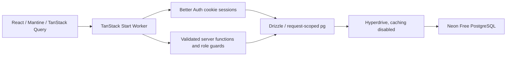

# Application architecture

Local development uses PostgreSQL 17 through Hyperdrive's local connection. CLI migrations and tests connect directly. Each request opens and closes a pg client; there is no global Worker pool or database client passed to browser code.

The auth handler owns `/api/auth/$`. Domain functions validate Zod inputs and derive actors from Better Auth cookies. SQL schema constraints enforce foreign keys, surah range, one grade per student/surah, one open review per student/surah, and one unused reset code per user.

Review close/cancel lock the assignment row. Closing-grade changes and assignment completion share a transaction. Reset redemption locks the account and code, consumes only once, changes credentials and removes sessions in one transaction; failed attempt counters commit before invalid-code errors. All admin role/status/delete operations share a transaction-scoped advisory lock and re-check actor authorization before applying last-admin rules.

Student and staff student-detail pages include a lazily mounted review-history tab. Its session-authorized GET function returns only completed/cancelled assignments for the selected student, with server-side status filtering and cursor pagination (20 rows plus one lookahead). Ordering uses closure date descending, null dates last, then assignment ID descending; the cursor also handles missing legacy closure dates. The UI displays the saved closing grade rather than the current grade, shows missing details explicitly and formats dates in UTC. History query keys share the reviews prefix, so existing close/cancel and grade-removal invalidations refresh history. Switching students resets the filter and cursor state. No polling, migration or new service is required.

Grades/reviews/notes use stable TanStack Query keys. Mutations invalidate affected keys. Login/logout perform a full document navigation, resetting private query caches. Focus/navigation refetch replaces subscriptions; polling remains off to permit Neon scale-to-zero. Student notes retain nullable staff authors after author deletion; student-owned data cascades on student deletion.

The student home dashboard uses the existing session-scoped grades, open-review and notes queries, sharing cache keys with `/surahs`. Progress counts each grade category and measures mastered (`good`) surahs out of 114, not pages, daily completion or all recorded grades. It previews five open reviews ordered by due date (undated last) and the three newest notes by creation date. Deadline counts use UTC calendar dates, matching review storage. Links select a validated `/surahs?tab=reviews|grades|notes` tab; individual reviews also link to their assignment anchor. Empty states show no invented activity. Teachers and admins now see a staff attention dashboard at home, taking precedence for mixed staff/student roles. A staff-only server function aggregates overdue open reviews and forgotten grades independently in one PostgreSQL statement, excluding disabled users and non-student roles. It returns school-wide totals and up to 20 active students ordered by oldest overdue date, then forgotten-grade count, name and ID. This follows the existing school-wide staff permissions; there is no teacher/class assignment model. The full student list remains available when the preview is capped. Staff links select a validated student-detail tab, and grade/review/student/account mutations invalidate the attention query. Pure students retain their private dashboard. Presentation-only fixtures remain available for Storybook. No polling, migration or additional hosting service is introduced. Neon/Hyperdrive provisioning and remote SQL smoke verification are complete. A separate development Worker was deployed and exercised through Hyperdrive/Neon. A confirmed database cold start passed, but actual Worker CPU measurements and HTTP 503 failures show the app is unreliable under the current CPU allowance. See [the hosted verification report](hosted-test-report-2026-10-14.md). Full hosted-suite completion on suitable hosting and production-origin verification remain launch steps.

The hosted findings follow-up upgrades Better Auth to 1.7.7 with compatible native scrypt and atomic PostgreSQL rate-limit counters. The development Worker now uses a separate Neon development branch/Hyperdrive. All five hosted browser checks passed; measured CPU remains above the documented Free allowance. See [the findings follow-up](hosted-findings-followup-2026-10-14.md) for the tested version, measurements and remaining hosting decision.
