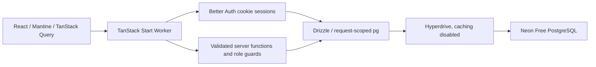

# Application architecture

Local development uses PostgreSQL 17 through Hyperdrive's local connection. CLI migrations and tests connect directly. Each request opens and closes a pg client; there is no global Worker pool or database client passed to browser code.

The auth handler owns `/api/auth/$`. Domain functions validate Zod inputs and derive actors from Better Auth cookies. SQL schema constraints enforce foreign keys, surah range, one grade per student/surah, one open review per student/surah, and one unused reset code per user.

Review close/cancel lock the assignment row. Closing-grade changes and assignment completion share a transaction. Reset redemption locks the account and code, consumes only once, changes credentials and removes sessions in one transaction; failed attempt counters commit before invalid-code errors. All admin role/status/delete operations share a transaction-scoped advisory lock and re-check actor authorization before applying last-admin rules.

Grades/reviews/notes use stable TanStack Query keys. Mutations invalidate affected keys. Login/logout perform a full document navigation, resetting private query caches. Focus/navigation refetch replaces subscriptions; polling remains off to permit Neon scale-to-zero. Student notes retain nullable staff authors after author deletion; student-owned data cascades on student deletion.

Home dashboard progress/courses/lessons remain presentation fixtures. Neon/Hyperdrive provisioning and remote SQL smoke verification are complete. A separate development Worker was deployed and exercised through Hyperdrive/Neon. A confirmed database cold start passed, but actual Worker CPU measurements and HTTP 503 failures show the app is unreliable under the current CPU allowance. See [the hosted verification report](hosted-test-report-2026-10-14.md). Full hosted-suite completion on suitable hosting and production-origin verification remain launch steps.
