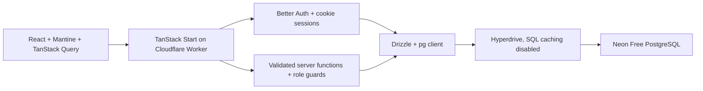

# Remove Convex Implementation Plan

> **For Codex:** REQUIRED SUB-SKILL: Use superpowers:executing-plans to implement this plan task-by-task.

**Goal:** Replace Convex with a SQL database and a backend inside TanStack Start, preserving the current Quran-school workflows and starting with fresh development data.

**Architecture:** Replace Convex with PostgreSQL on Neon Free, Drizzle, Better Auth hosted by the app, and TanStack Start server functions consumed through TanStack Query. Retain the current Cloudflare Worker initially, connecting through Hyperdrive and a request-scoped PostgreSQL client. Use ordinary PostgreSQL transactions for review/reset/account operations. Existing Convex data and sessions need not be migrated.

**Tech Stack:** React 19, Mantine, TanStack Start/Router/Query, Better Auth, Neon Free PostgreSQL, Drizzle ORM/Kit, node-postgres (`pg`), Zod, Vitest, Playwright; current Cloudflare Workers + Hyperdrive for hosting/connectivity.

---

Execution note: the template's `superpowers:executing-plans` skill is not installed in this workspace. This plan is self-contained; its checklist and acceptance criteria can be executed directly. This is a planning document, not authorization to deploy or delete remote resources.

## Execution checkpoint — October 13, 2026

Local implementation is complete: PostgreSQL/Drizzle, app-owned Better Auth, domain services/server functions, Query invalidation, scripts, migrations, CI and active Convex removal are implemented. Verification: 25 PostgreSQL tests and four browser tests passed; build/typecheck/lint passed. See [implementation report](../migration-report-2026-10-13.md).

The selected existing Neon project/branch was migrated, direct SQL and hosted Better Auth smoke checks passed, and Hyperdrive was provisioned with caching disabled and verified TLS. A temporary remote Worker passed the real Hyperdrive/Neon SQL rollback and reconnect check. Claude's approved implementation review completed; concrete findings were fixed and tested. No paid upgrade or production app deployment occurred. Launch gates remain: full-app deployed CPU, final-origin auth/session checks, Neon cold starts and distributed sign-in limiting.

## Decisions and scope

- Confirmed: remove Convex; the project is early enough that old data can be discarded.
- Latest user requirement: replace D1 with a free database service. Recommended implementation target: Neon Free PostgreSQL + Drizzle, keeping Better Auth. The earlier D1 choice is superseded; Cloudflare remains the app host unless a separate zero-cost hosting decision is made.
- Recreate development users and demo data. No export/import, old-session compatibility, dual writes, or permanent two-backend architecture.
- Keep Arabic RTL UI and its component/storybook work. Preserve grades, review assignments, teacher notes, student creation, role restrictions, login/profile/logout, and admin-mediated password resets.
- Keep existing multi-role semantics: a user may have more than one of admin/teacher/student.
- Domain operations become ordinary validated server functions. Keep one application; no separate API service or tRPC layer is needed for this scope.
- Replace Convex subscriptions with invalidation after writes and refetch on focus/navigation. Keep polling off by default so background traffic does not keep Neon compute awake. Cross-browser updates become eventual; add opt-in polling only after measuring quotas.
- Dashboard fixture data remains outside this migration. Remove the Convex numbers/demo page rather than porting it.
- Do not delete the Convex cloud project during implementation. Local removal is enough to prove independence; remote cleanup can follow once the replacement works.

## Selected architecture and provider comparison

Use **Neon Free PostgreSQL + Drizzle**, retaining the existing Better Auth configuration in the app. This is a database replacement; Neon's optional managed auth/functions/storage products are not required. Supabase is a valid alternative if storage/realtime/Supabase Auth later becomes a product requirement. Turso is a free SQLite alternative, but PostgreSQL simplifies the current multi-row transactional flows.

| Provider | Free database offering checked October 13, 2026 | Fit for this project |
| --- | --- | --- |
| Neon — recommended | 1 GB/project; 100 CU-hours/project/month; 5 GB transfer/project | PostgreSQL, scale-to-zero and development branches; works with existing Better Auth |
| Supabase | 500 MB database; two active projects; 5 GB egress; pauses after one inactive week | Useful bundled services, but we currently only need PostgreSQL |
| Turso | 5 GB; 500 million rows read/month; 10 million rows written/month | Viable SQLite option; different transaction/schema/driver choices |

Sources: [Neon pricing](https://neon.com/pricing), [Supabase pricing](https://supabase.com/pricing), [Turso pricing](https://turso.tech/pricing).



Use request-scoped native `pg` clients through Hyperdrive, closing connections after use. Point Hyperdrive at a direct Neon origin URL with Neon's connection-pooling toggle off: Hyperdrive itself owns pooling. Local app connections target local PostgreSQL; migrations use direct credentials. No database access or arbitrary-SQL endpoint is exposed to the browser. [Neon Workers integration](https://neon.com/docs/guides/cloudflare-workers).

Disable Hyperdrive query caching for auth, permissions and post-mutation reads. SQL caching otherwise can serve pre-write results despite a React Query refetch. [Hyperdrive caching](https://developers.cloudflare.com/hyperdrive/concepts/query-caching/).

## Costs and free-tier budget

Pricing checked October 13, 2026; USD, before taxes. Target **$0/month for the database**. App hosting is a separate cost; changing D1 to Neon does not relocate SSR or password hashing out of the Worker.

| Component/scenario | Budget | Conditions |
| --- | --- | --- |
| Local PostgreSQL + local app/tests | $0 platform usage | Runs on the developer's machine |
| Neon database | **$0/month** | Stay within Free compute, storage and transfer allowances |
| Hyperdrive connectivity | $0 separate fee | Included with Workers; Free allows 100,000 DB statements/day, Paid is unlimited |
| Entire existing Cloudflare-hosted stack on Free | **$0/month** | Worker CPU/request and Hyperdrive limits also pass |
| Cloudflare Paid + Neon Free | **$5/month baseline** | Hosting account minimum, not a Neon database fee; usage overages possible |
| Optional Render Free Node app + Neon Free | **$0/month** | Separate hosting change; free-tier sleeping/usage limitations below |

Neon Free includes 1 GB PostgreSQL storage, 100 CU-hours monthly and 5 GB transfer per project; 10 branches are included. It suspends compute after five idle minutes. At 0.25 CU, 400 active hours use the compute allowance. Exhausted compute/transfer suspends service until reset or upgrade; storage exhaustion blocks growth. These are finite free allowances, not unlimited production capacity. [Neon plan limits](https://neon.com/docs/introduction/plans).

**Illustrative development budget:** one 0.25-CU compute active eight hours/day for 30 days uses 60 CU-hours. With 0.3 GB storage and 1 GB transfer, Neon stays at $0. This is an assumption, not a measured forecast. Count every branch compute and its idle tail; continuous polling can prevent scale-to-zero. A 0.25-CU compute active 24 hours/day for 30 days uses 180 CU-hours, exceeding Free.

Cloudflare Workers Free still has a 10-ms CPU ceiling/request. Secure password hashing and SSR need measurement. Paid starts at $5/account/month with 10 million requests and 30 million CPU ms included; excess is $0.30/million requests and $0.02/million CPU ms. Hyperdrive has no separate subscription here. [Workers pricing](https://developers.cloudflare.com/workers/platform/pricing/), [Hyperdrive pricing](https://developers.cloudflare.com/hyperdrive/platform/pricing/).

**If the whole deployed project must remain $0:** an optional Render Free web service can host the TanStack Start Node server with Neon Free as its database. This requires replacing the Cloudflare-specific deployment build. Render's free service sleeps after 15 idle minutes and can take about a minute to restart; it is suited to development/demo use, with bandwidth/build/service-hour limits. Use Neon rather than Render's time-limited free database. This is an alternative, not an automatic hosting change. [Render Free](https://render.com/docs/free).

Better Auth remains application-owned; there is no new auth subscription. Custom domain registration, taxes, optional CI/logging overages, account-wide unrelated usage and one-time implementation/AI-tool usage are outside these totals. No paid plan or infrastructure is provisioned by planning.

**Cost controls:** keep polling off by default; bound/index list queries; use local PostgreSQL for automated tests; remove unused dev branches; inspect Neon compute/storage/egress and Hyperdrive query counts; measure actual password hashing and SSR CPU. Free database quotas do not guarantee $0 app hosting, and usage alerts are not a spending cap.

## Current dependency map

| Convex responsibility | Replacement |
| --- | --- |
| `convex/schema.ts` and component auth tables | Drizzle app schema + generated Better Auth SQL schema + versioned migrations |
| `convex/auth.ts`, auth component, HTTP router | Better Auth instance inside the application; `/api/auth/$` handles requests directly |
| JWT/token bridge in `src/lib/auth-server.ts` | Cookie-based Better Auth session lookup on the server |
| `convex/auth/helpers.ts` | Server-side session, active-account, staff/admin, self-or-staff guards |
| `convex/surahGrades.ts` | Grade service + server functions |
| `convex/surahReviews.ts` | Review service + server functions + PostgreSQL transaction |
| `convex/studentNotes.ts` | Notes service + server functions + author join |
| `convex/auth/admin.ts`, `users.ts`, `resetCodes.ts` | Account/session services + server functions; local/admin scripts |
| `convexQuery`, Convex query client and React provider | TanStack Query `queryOptions`, HTTP server-function calls, explicit invalidation |
| `useAction` / Convex `useMutation` | TanStack Query `useMutation` calling validated server functions |
| Generated `Id` types and Convex validators/errors | Application DTOs/string IDs, Zod validation, typed application errors |
| Convex CLI deployment/code generation | SQL migrations, database bootstrap/seed, Worker deploy |

There are no application file-storage integrations or domain cron jobs to replace. The Better Auth runtime and current reset-code flow are the most coupled parts. Pure presentation components can retain their props.

Source inspection also shows that most admin account-management APIs currently have no frontend callers. The existing admin UI exposes reset-code issuance, while staff UI exposes student creation. Do not treat the setup guide's reference to a full admin UI as an implemented feature. Port backend capabilities deliberately; building additional admin screens is outside this migration.

## Target layout

```text
src/server/
  db.server.ts                 request-aware PostgreSQL client and Drizzle factory
  auth.server.ts               Better Auth factory and SQL adapter
  auth-guards.server.ts        session-derived authorization
  errors.ts                    safe serializable application error contracts
  db/schema/auth.ts            generated auth schema, reviewed and committed
  db/schema/app.ts             grades, reviews, notes, reset codes
  services/accounts.server.ts
  services/grades.server.ts
  services/reviews.server.ts
  services/notes.server.ts
  services/reset-codes.server.ts
  functions/session.ts
  functions/accounts.ts
  functions/grades.ts
  functions/reviews.ts
  functions/notes.ts
  functions/reset-codes.ts
src/lib/queries/
  keys.ts
  session.ts
  students.ts
  grades.ts
  reviews.ts
  notes.ts
drizzle/
scripts/db-migrate.ts
docker-compose.yml
scripts/seed-dev.ts
scripts/bootstrap-admin.ts
scripts/rescue-reset-password.ts
tests/integration/
tests/e2e/
```

Server-function modules can be imported by route code; database/auth implementation modules must remain server-only. Return DTOs, not database clients or full credential/session records.

## Data rules to preserve or enforce

| Table | Constraints / behavior |
| --- | --- |
| Better Auth `user`, `session`, `account`, `verification` | Generate for the installed, deliberately chosen Better Auth version and enabled admin/username plugins; canonical username/email uniqueness; auth-managed credentials |
| `student_surah_grades` | Unique `(student_id, surah_number)`; surah integer 1–114; grade enum; updater and timestamp |
| `surah_review_assignments` | Status enum; unique `(student_id, surah_number)` where status is open; indexed student/status/due date; close/cancel only from open state |
| `student_notes` | Trimmed nonempty body, at most 2,000 characters; student/author foreign keys; created and optional edited timestamps; latest 100 notes, with author name joined |
| `password_reset_codes` | One live code per user; hash, expiry, attempt count, issuer and consumed state; at most one successful redemption |

Use ordinary string IDs throughout API DTOs, with a consistent generation strategy. Store PostgreSQL timestamps and serialize them as epoch milliseconds to preserve component contracts. Keep surah metadata in `src/data/surahs.ts`; adding a database table for static metadata is unnecessary.

Account deletion policy: remove a student's owned records when the student is deleted; retain authored notes/audit history if a staff author is deleted by making author/audit references nullable and displaying the existing deleted-user fallback. Do not cascade-delete a teacher's notes from other students. UI account disabling remains a ban plus session revocation.

Use PostgreSQL partial unique indexes for open reviews and unused reset codes per user. Review generated SQL and prove both indexes in integration tests. PostgreSQL supports uniqueness over a subset of rows. [Partial indexes](https://www.postgresql.org/docs/current/indexes-partial.html).

## Implementation tasks

Each task is a reviewable checkpoint. Within it, add the named failing test, run it, implement one behavior at a time, rerun focused tests, and commit only files owned by that task. Never stage the whole dirty checkout.

### Task 1: Prove Neon/PostgreSQL connectivity and the hosting runtime

**Create:** `docker-compose.yml`, `drizzle.config.ts`, `src/server/db.server.ts`, `vitest.config.ts`, `tests/integration/db-runtime.test.ts`.
**Modify:** `package.json`, `package-lock.json`, `wrangler.jsonc`, `.env.example`, `vite.config.ts`.

1. Record compatible PostgreSQL/Drizzle/pg versions. Keep Better Auth pinned initially; do not copy current documentation imports without checking 1.5.3 exports and its SQL-adapter dependency.
2. Add local PostgreSQL for repeatable offline development/integration tests and `db:generate`, `db:migrate`, `db:seed`, `test`, `test:e2e` scripts. Plan separate Neon development/production branches within the Free quotas; reuse existing project/connection configuration if supplied. Add a cache-disabled Hyperdrive binding and generate its Worker types. Secrets stay server-only.
3. Write tests for a simple PostgreSQL query, committed multi-write transaction, deliberate rollback and client cleanup. Run `npm run test -- tests/integration/db-runtime.test.ts` and confirm failures before wiring the DB.
4. Implement a request-aware factory using `pg` + `drizzle-orm/node-postgres` and `env.HYPERDRIVE.connectionString`; close the client after use. Use a direct Neon URL as Hyperdrive's origin, because Hyperdrive already pools connections. CLI migrations use a direct URL; the local app targets local PostgreSQL through the local Hyperdrive connection, while Node integration tests connect directly to the isolated local test DB. Run a separate connection/transaction smoke test against a Neon dev branch. Never put DB URLs in browser variables.
5. Verify a Better Auth password hash/verify operation in the actual Worker development runtime and the intended hosting plan's CPU budget, not only Node tests. Do not weaken the password hash to fit the runtime. Claude raised Worker CPU limits as a risk; measure it instead of assuming either Free or Paid will pass.
6. Gate: PostgreSQL rollback/locking, cold-start reconnection, password hashing, binding lifecycle and cookies work in the Worker. Measure CPU and Neon compute use. If a completely free hosted app is required and Worker CPU fails its Free limit, use the optional Node-host route below rather than weakening password hashing. No paid upgrade is part of planning.

### Task 2: Build fresh SQL schemas and migrations

**Create:** `src/server/db/schema/auth.ts`, `src/server/db/schema/app.ts`, `drizzle/`, `scripts/db-migrate.ts`, `tests/integration/schema.test.ts`.

1. Generate Better Auth's PostgreSQL schema using the version-matched generator and admin/username plugin configuration. Inspect tables; do not copy every unused table from the Convex component. Use the Drizzle adapter's `pg` provider.
2. Add the application tables and the constraints listed above. Add foreign keys and indexes before service implementation.
3. Test duplicate grades, duplicate open reviews, legal closed-review history, out-of-range surahs, and foreign-key violations. Constraints must reject invalid rows.
4. Generate reviewed PostgreSQL migrations and apply them to an empty local DB, then an isolated Neon dev branch using a direct connection. Do not depend on ad hoc schema pushes. Remote production migration is separate and explicit.
5. Gate: repeated startup needs no schema changes; migration from empty DB passes.

### Task 3: Move authentication into the app

**Create:** `src/server/auth.server.ts`, `src/server/auth-guards.server.ts`, `src/server/functions/session.ts`, `tests/integration/auth.test.ts`.
**Modify:** `src/routes/api/auth/$.ts`, `src/lib/auth-client.ts`, `src/lib/auth-server.ts`, `src/lib/auth.ts`, `src/lib/auth-queries.ts`, `src/routes/_protected/route.tsx`, `src/routes/_protected/staff/route.tsx`, `src/routes/_protected/admin/route.tsx`, `src/routes/login.tsx`.

1. Configure Better Auth with its Drizzle PostgreSQL adapter, username and admin plugins, public signup disabled, the existing multi-role model, and server-only secrets/site URL. Keep session cookie caching off initially so bans/revocation are checked against current DB state. Use Neon for the database only; do not also introduce Neon Auth or Supabase Auth.
2. Make `/api/auth/$` call the local auth handler, replacing the Convex HTTP proxy. Retain browser auth-client sign-in/sign-out behavior.
3. Resolve sessions from request cookies via `auth.api.getSession`; remove Convex JWT/token round trips. If server auth calls set cookies, use the installed version's TanStack cookie integration. [Better Auth TanStack integration](https://better-auth.com/docs/integrations/tanstack).
4. Implement active-user, staff, admin and self-or-staff guards; derive actor IDs exclusively from the server session. Target student IDs are resources, not evidence of authorization.
5. Test username/email login, logout, protected redirects, bans, session revocation, staff/admin differences and disabled-account navigation. Prevent redirect loops for a signed-in disabled user and validate login redirect destinations as local paths.
6. Gate: protected routes and direct backend calls enforce the same permission matrix. Session failure and database outage remain distinguishable.

### Task 4: Port account management, bootstrap and demo seed

**Create:** `src/server/services/accounts.server.ts`, `src/server/functions/accounts.ts`, `scripts/bootstrap-admin.ts`, `scripts/rescue-reset-password.ts`, `scripts/seed-dev.ts`, `tests/integration/accounts.test.ts`.
**Modify:** `src/components/staff/CreateStudentDrawer/CreateStudentDrawer.tsx` only if its error contract requires it.

1. Port username/display-name/email normalization and the optional-email placeholder behavior; keep one normalization implementation.
2. Preserve admin account CRUD, role/status operations and direct password reset APIs even where UI is limited. Teachers can create students only; role is fixed server-side.
3. Do not pass a teacher session to an admin-only Better Auth operation and assume it will work. Use a staff-guarded server service with narrowly controlled account creation.
4. Prevent concurrent attempts to disable/demote the last active admin by acquiring a shared transaction-scoped advisory lock (the same key for every admin role/status mutation), checking remaining active admins and applying changes in one transaction. Include session deletion for a ban. A read-then-update outside that transaction, or a generic conditional predicate without serialization, is insufficient. Test simultaneous demotions/bans.
5. Bootstrap/rescue scripts run only with server/deployment access. Bootstrap refuses when users already exist. No public bootstrap/rescue endpoint.
6. Seed local admin/teacher/student accounts and a few grades, reviews and notes. Keep credentials supplied by environment/local operator; allow repeatable local reset and seed. The dev seed must not run during production startup.
7. Tests: duplicates, case normalization, role escalation attempts, simultaneous admin demotions, session revocation on disable, repeat bootstrap.

### Task 5: Port grades

**Create:** `src/server/services/grades.server.ts`, `src/server/functions/grades.ts`, `tests/integration/grades.test.ts`.

1. Add validated read/list/upsert/remove operations matching the current DTOs. Validate the target is an actual student, not merely an existing arbitrary user.
2. List active students using SQL and preserve Arabic display-name sorting. Avoid accidentally replacing Arabic collation with the database's default ordering.
3. Self-or-staff read; staff grade writes; admin-only grade removal. Record actor and timestamp on each write.
4. Tests: isolation between students, role matrix, concurrent upsert uniqueness, invalid surah/grade, admin-only removal.

### Task 6: Port reviews with PostgreSQL transactions

**Create:** `src/server/services/reviews.server.ts`, `src/server/functions/reviews.ts`, `tests/integration/reviews.test.ts`.

1. Preserve assignment eligibility: the student must already have a grade for that surah. Let the unique open-review constraint enforce concurrent duplicate rejection.
2. Sort by due date with undated reviews last, then assignment time. Preserve the existing date/epoch contract and timezone behavior.
3. In one PostgreSQL transaction, lock the assignment row, require open status, optionally upsert its grade, capture the closing-grade snapshot and mark the assignment closed. Two concurrent closes must not both succeed. Forced failure between grade update and assignment close must roll back both writes.
4. Cancel only an open assignment; prevent close/cancel races from changing a completed assignment again.
5. Tests: missing grade, duplicate assign race, optional date, forced rollback between grade update and close, close/close and close/cancel races, resulting closing-grade snapshot.

### Task 7: Port authored student notes

**Create:** `src/server/services/notes.server.ts`, `src/server/functions/notes.ts`, `tests/integration/notes.test.ts`.

1. Implement latest-note reads with author name joined, self-or-staff permissions and a 100-row bound.
2. Add/trim/validate notes as staff. Edit/delete only when the caller is the original author, including for admins; preserve existing behavior.
3. Keep the 2,000-character constraint shared by UI and backend. Preserve edited timestamp and deleted-author fallback.
4. Tests: whitespace/oversize input, cross-student reads, nonauthor edits/deletes, deleted-author behavior, ordering and bound.

### Task 8: Rebuild admin-mediated reset codes safely

**Create:** `src/server/services/reset-codes.server.ts`, `src/server/functions/reset-codes.ts`, `tests/integration/reset-codes.test.ts`.
**Modify:** `src/routes/reset-password.tsx`, `src/routes/_protected/admin/reset-password.tsx`.

1. Preserve six-digit admin-issued codes, 30-minute default TTL, five failed attempts, generic invalid/expired responses, disabled-account rejection, and session revocation after reset.
2. Issuing a new code invalidates earlier codes for that user. Persist a hash rather than a plaintext code; bind lookup and attempt counting to the target user.
3. Implement an atomic single-use claim. The current Convex helper called `validateAndReserveCode` only increments attempts and returns the token, while `usedAt` is set later: do not copy that as a concurrency-safe reservation.
4. Increment failed attempts atomically and commit the increment independently of any subsequent validation error. For a valid redemption, compute the configured Better Auth hash, then lock/recheck the code and account in a PostgreSQL transaction; consume the code, update credentials and delete sessions together. Reject a lost claim or missing credential row; forced failure rolls back the successful-redemption writes. Drop captured plaintext Better Auth tokens from the new schema. Isolate any direct auth-table writes in this one version-tested service and match the configured hash/verification contract.
5. Tests must force two simultaneous valid redemptions and verify only one password update succeeds; cover wrong attempts, expiry, new-code invalidation, replay, failure recovery and revoked sessions.
6. Gate: public signed-out reset works without any authenticated-client initialization requirement.

### Task 9: Replace frontend data access and SSR integration

**Create:** `src/lib/queries/{keys,session,students,grades,reviews,notes}.ts`, `src/server/errors.ts`, `tests/integration/server-functions.test.ts`.
**Modify:** `src/router.tsx`, `src/routes/__root.tsx`, `src/routes/_protected/{index,profile,surahs}.tsx`, `src/routes/_protected/staff/students/index.tsx`, `src/routes/_protected/staff/students/$studentId.tsx` and both reset routes.

1. Remove Convex provider, client, hash/query functions, `serverHttpClient` auth setup and generated API/ID imports. Keep the existing TanStack Query provider/SSR bridge and a per-request QueryClient.
2. Put Zod `inputValidator` validation and backend auth middleware on server functions. The installed TanStack Start source uses `.inputValidator`; avoid outdated `.validator` examples.
3. Define stable keys: `['session']`, `['students']`, `['grades', studentId]`, `['reviews', studentId]`, `['notes', studentId]`. Use the same query options in loaders and components.
4. Example mutation contract:

   ```tsx
   const mutation = useMutation({
     mutationFn: (data: SetGradeInput) => setGrade({ data }),
     onSuccess: (_, input) => queryClient.invalidateQueries({
       queryKey: ['grades', input.studentId],
     }),
   })
   ```

5. Invalidate grades + reviews after review close; reviews after assign/cancel; notes after note writes; students after creation; session/all private data on account changes, login/logout and password reset. Clear previous-user cache before another account is shown.
6. Document refetch/polling behavior for a separate student browser. Avoid claiming local mutation invalidation updates other browsers.
7. Translate validation/domain errors into existing Arabic UI messages; keep unexpected exceptions in server logs. Routes must not render raw server stacks to users.
8. Gate: direct URL SSR, client navigation, reload, mutation feedback, account switching and mobile layout work without Convex network requests.

### Task 10: Remove Convex and update workflows

**Remove:** `convex/`, `src/lib/convex-errors.ts`, `src/routes/_protected/anotherPage.tsx`, `scripts/bootstrap-admin.mjs` once replaced.
**Modify:** `package.json`, `package-lock.json`, `eslint.config.mjs`, `vite.config.ts`, `wrangler.jsonc`, `.github/workflows/deploy.yml`, `.env.example`, `AGENTS.md`, `CLAUDE.md`, `AUTH_SETUP.md`, `SETUP.md`, `docs/architecture.md`, `src/components/staff/AddNoteDrawer/AddNoteDrawer.tsx`, `skills-lock.json` and Convex-specific project skill/config references as applicable.

1. Remove `convex`, `@convex-dev/better-auth`, `@convex-dev/react-query`, `@convex-dev/eslint-plugin`; remove push/watch/deploy scripts and the Vite SSR exception for the bridge.
2. Regenerate the route tree with the router tooling after removing the demo route. Remove the `numbers` table rather than translating the template example.
3. Dev workflow: local PostgreSQL + one app server; use a separate Neon dev branch for hosted integration smoke checks. Production workflow: test/build, reviewed PostgreSQL migrations via a direct Neon connection, then Worker deploy; bootstrap is an operator step. CI uses a PostgreSQL service/container, not the production database.
4. Remove Convex URLs/keys from active environment/CI configuration. Add Hyperdrive connectivity, server-only auth secret, site URL and separate direct migration credentials; no DB/auth secrets in `VITE_*` variables. Monitor Neon compute/storage/egress and Worker usage before launch.
5. Rewrite active architecture/auth/setup documents and project instructions. Historical plan/report documents may retain references, clearly marked as pre-migration.
6. Check `rg -n 'convex|Convex' src scripts package.json vite.config.ts eslint.config.mjs wrangler.jsonc .github .env.example`: no active references expected. Also inspect repository-level metadata/skills for obsolete backend guidance.
7. Keep deployment provisioning and remote Convex teardown as explicit follow-up actions after local acceptance; a plan does not execute either.

## Acceptance and verification

**Create:** `playwright.config.ts`, `tests/e2e/auth.spec.ts`, `tests/e2e/student-teacher.spec.ts`, `tests/e2e/password-reset.spec.ts`.

Run:

```bash
docker compose up -d db
npm run db:migrate
npm run db:seed
npm run test
npm run lint
npm run build
npm run test:e2e
```

`db:migrate` targets the explicit local PostgreSQL connection; `db:seed` uses that same local DB. Start `npm run dev:web` for manual testing; E2E configuration manages its test server. Dev-branch and production migrations require distinct targets and direct connection strings; never silently fall back to production.

Acceptance tests cover `docs/local-test-report-2026-10-13.md` plus concurrency and isolation cases. Use two browser contexts and fresh test DB state. PostgreSQL integration tests must use PostgreSQL, not SQLite or mocked transactions. Run a separate Worker/Hyperdrive/Neon smoke test for lifecycle and reconnect behavior; measure deployed hashing/SSR CPU separately from local timing.

Done means:

- Fresh install/migrate/seed/start works locally without Convex credentials or network access to Convex.
- All current product workflows and permission boundaries pass browser and backend tests.
- Grade/review consistency and reset-code single use hold under concurrent requests and forced failures.
- SSR session isolation and account switching cannot reveal another user's cached data.
- Build/typecheck/lint pass; browser console has no new hydration/auth errors.
- Production configuration has one app deployment and SQL migration workflow, with verified Worker/database runtime compatibility.
- Old data and sessions have been intentionally replaced; fresh accounts are available through seed/bootstrap.

## Claude Code review

The consultation completed successfully through the locally installed Claude Code CLI, with read-only source tools. Its complete response is saved in `docs/plans/2026-10-13-remove-convex-claude-advice.md`. It inspected the backend, auth integration, router, deployment config, and selected routes; it explicitly did not inspect every route/component body or environment files.

**Claude's recommendation:** keep the existing Worker, use D1 + Drizzle, and host Better Auth inside the app. Prove atomic review/reset operations and password-hashing runtime feasibility first; use PostgreSQL if those gates fail. It recommends simplifying to server functions and TanStack Query invalidation, with no realtime infrastructure initially.

**Latest direction:** the user subsequently requested a free service such as Neon or Supabase instead of D1. This plan recommends Neon Free PostgreSQL + Drizzle, retaining Better Auth. It supersedes the intermediate D1 plan. Claude's original advice remains a historical comparison; it was not a new review of this Neon-specific revision.

**Accepted review points:**

- Put runtime/hash/atomicity checks first; set up tests during the port, not afterward.
- Keep Better Auth pinned and verify its version-matched SQL-adapter package; do not assume a re-export guarantees the dependency is installed.
- Switch auth handler and browser client together; do not use a session split between Convex and SQL.
- Treat headerless admin calls as privileged server calls requiring an explicit staff/admin guard; keep teacher-created role fixed to student.
- Use SQL uniqueness constraints and concurrent-request tests rather than relying on preflight reads.
- Explicitly handle single-use reset claims, session revocation, fresh account-status reads, and cross-browser refetch behavior.
- Remove the template numbers page and unused Convex/JWT auth tables instead of carrying them forward.
- Keep the migration small: no new admin UI, no separate backend service, no data preservation pipeline.

**Advice requiring qualification:**

- D1 supports atomic batches; saying it has no transactions would be misleading. It does not provide the same interactive transaction workflow as PostgreSQL.
- Do not use matching `closed_at` milliseconds and actor ID as the sole ownership marker for a D1 conditional close+grade batch. Concurrent requests can share both. Use a unique operation ID or a SQL design whose write depends on a uniquely claimed operation, then test close/close and close/cancel races.
- On PostgreSQL, last-admin checks require transaction-scoped serialization; preserve the shared advisory-lock design in Task 4.
- Reset-code claims and wrong-attempt increments need distinct tests. Avoid throwing inside a transaction in a way that rolls back the failed-attempt counter. Never update a password from a code that another request has claimed.
- Worker hash performance and any proposed vendor's prices/limits remain spike results, not guarantees based on the advisor's estimates.

## Remaining implementation choices

1. Database cost target: stay on Neon Free. Reassess capacity before any paid upgrade; compute exhaustion is an availability constraint, not authorization to spend.
2. App hosting: retain Cloudflare for now, but choose the optional free Node host if a $0 total hosting budget is required and Free Workers cannot handle hashing/SSR.

3. Student freshness: focus/navigation refetch initially; add polling only after measuring its effect on compute hours.

Old-data preservation is settled: it is unnecessary. Creating/linking a Neon project, any paid upgrade and deployment remain subsequent execution actions, not actions performed by this plan.
